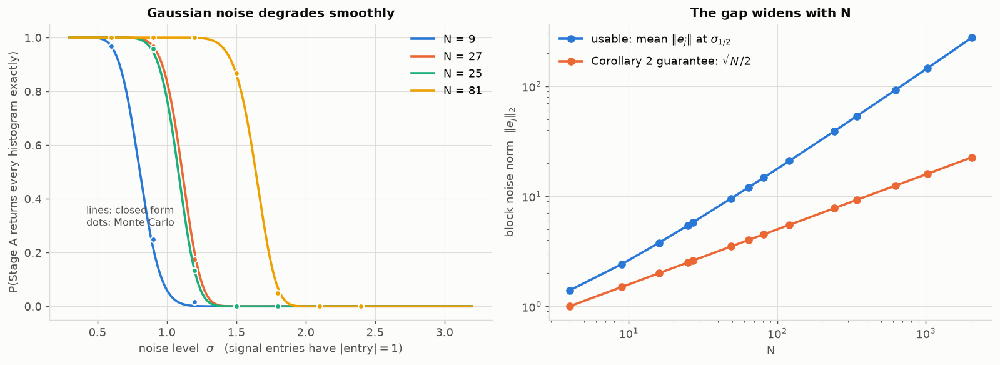
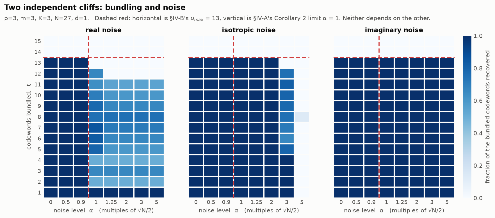

# Histogram-recovery VSA

An implementation of Deng and Raviv, *Efficient Vector Symbolic Architectures from
Histogram Recovery* (arXiv:2511.01838), with the two borrowed algorithms it depends on.
All four source papers are in the repo as PDFs (gitignored, so `ls *.pdf` to see them).

**[REPORT.md](REPORT.md)** — a worked write-up: how decoding happens step by step, how
Gaussian noise affects recovery (120,000 decodes), and whether raising the
Guruswami-Sudan multiplicity `d` buys anything (it does not — `d` cancels out of the
binding inequality).

## The whole thing in one page

**Encoding.** Take a message, push it through three layers:

```
message  ->  Reed-Solomon  ->  Hadamard  ->  phi  ->  hypervector
```

1. **Message** — `K` symbols from `F_{p^m}`.
2. **Reed-Solomon** — treat them as polynomial coefficients and evaluate at all
   `N = p^m` field elements. Now you have `N` symbols.
3. **Hadamard** — replace each symbol by its column of the `N x N` Hadamard matrix.
   Now you have `N` blocks of `N` entries.
4. **phi** — map each `F_p` entry `k` to the root of unity `exp(2*pi*i*k/p)`.

Result: `p^(2m)` complex numbers, every one of modulus 1.

**The two operations.** Given hypervectors, there are exactly two things you do:

| | what you do | what it means | stays a codeword? |
|---|---|---|---|
| **bind** | multiply entry by entry | glue attributes into one object | **yes** |
| **bundle** | add entry by entry | put several objects in one vector | **no** |

Binding stays inside the codeword set because the `p`-th roots of unity are closed under
multiplication. Bundling leaves it — the moduli stop being 1. That single difference is
why binding is trivially reversible and bundling needs two whole papers.

## The notebooks, in order

### `encode.ipynb` — the encoder, simplest case

`m = 1`, so the alphabet is just `F_p` and all arithmetic is `% p`. Start here.
Uses `p = 5, K = 2`.

### `encode_m.ipynb` — the encoder, general case

Same three steps over `F_{p^m}`. What changes: `N = p^m` instead of `p`, and field
arithmetic needs lookup tables instead of `% p`. What does not: `phi`, and every bound.
See [readme_m.md](readme_m.md) for the full diff.

Also contains binding, the quasi-orthogonality checks, and the `l_max` measurements.

### `guruswami_sudan.ipynb` — repair **one** damaged codeword

**Problem:** you have a single codeword and some of its symbols are wrong.

Classical decoding fixes up to `(d-1)/2` errors, because past that the nearest codeword
stops being unique. Guruswami-Sudan gives up on uniqueness and returns a short *list*.

```
1. interpolate  -- find a curve Q(x,y) through all N received points (x_j, r_j)
2. factor       -- find every f with deg f < K such that (y - f(x)) divides Q
3. filter       -- keep the f whose codeword is within tau of what you received
```

Steps 1-2 are the algorithm; step 3 is a distance check. On a `[16, 2, 15]` code:
**11 errors corrected against 7** for classical decoding. The ceiling is the Johnson
radius, `N - sqrt(N(K-1))` = 12.

Uses Sage's `GRSGuruswamiSudanDecoder` via `passagemath` — the only off-the-shelf
Guruswami-Sudan implementation reachable from Python. Source paper:
`Improved_decoding_of_Reed-Solomon_and_algebraic-geometric_codes.pdf`.

### `sidorenko_fischer.ipynb` — pull a **bundle** apart

**Problem:** you have a sum of `t` hypervectors and want to know which `t` they were.

This is harder than the above, because a bundle is not a damaged codeword — it is not a
codeword at all. Two stages:

```
IV-A:  un-apply phi and Hadamard, block by block
       ->  h_j = (1/N) H^dagger s_j
       ->  a histogram: how many of the t codewords had symbol a at position j

IV-B:  throw the counts away, keep only WHICH symbols appeared  ->  Y
       1. interpolate  -- a curve through every (position, symbol) pair in Y
       2. factor       -- same y-root extraction as above
       3. filter       -- keep candidates whose every symbol was actually observed
```

Stage IV-A is exact and is one matrix multiply (`H^dagger H = N I`) followed by a
rounding. That rounding is the paper's **Corollary 1** -- Lemma 1 shows the Voronoi cell
of this lattice makes nearest-point decoding identical to coordinatewise rounding, and
Corollary 2 gives the usable sufficient condition `||e_i||_2 < sqrt(N)/2`. Stage IV-B is
Sidorenko-Fischer's Algorithm 2; steps 1-2 are theirs, step 3 is this paper's addition.
Source paper: `Low-Complexity_List_Decoding_of_Reed-Solomon_Coded_Pulse_Position_Modulation.pdf`.

The notebook also checks itself against that paper directly — cost `C(M)`, Theorem 1,
the list-size bound, and the adaptive multiplicity rule.

### `gaussian_noise.ipynb` — what a real channel does

The app's noise probe fixes `||e_j||` to a chosen value; a real system perturbs every
entry independently and normally. Under that model Stage A has an **exact closed form**
rather than a bound:

```
P(Stage A exact) = erf( sqrt(N) / 2*sigma ) ^ (N^2)
```

because `a = Re(H'e)/N` has i.i.d. `N(0, sigma^2/2N)` coordinates and Lemma 1 needs all
`N^2` of them inside `(-0.5, 0.5)`. Verified against Monte Carlo at several `N`.

Two consequences: the cliff at Corollary 2's threshold becomes a smooth curve, and the
bound turns out to be conservative by a factor that **grows with N** — about `2x` at
`N = 27`, over `12x` at `N = 2048`, following `sigma ~ sqrt(N / log N)`. Bigger fields
are more noise-robust, because the Hadamard transform averages noise over `N` entries
and that gain outruns the `N^2` coordinates that must stay in range.



### `demo.ipynb` — all of it, end to end

One non-degenerate code (`p = 3, m = 3, K = 3`, so `N = 27`, `dim = 729`):

1. encode named attributes as atoms,
2. **bind** three atoms into an object, and recover the attributes back out,
3. **bundle** several objects, and recover the set,
4. sweep `m`, `K`, `p` to high values against every bound.

Binding recovery is *not* list decoding. Because each attribute owns its own message
coordinate, the bound vector is itself a codeword, so you decode it and read off the
slots. That follows `linear.pdf` Theorem 2 (solve `x . B = c`, split the coefficients by
subcode).

### `streamlit_app/` — the same thing with sliders

`histogram_recovery.ipynb` with `(p, m, K, d)` moved into a sidebar, so you can drag the
parameters and watch the `u_max` cliff move.

```bash
uv sync --group app --group sage
uv run --group app --group sage streamlit run streamlit_app/app.py
```



Eight tabs, formatted the way the notebook formats things — same monospace tables,
same `show_histogram`, same `f(x) = ...` lines — plus two noise tabs the notebook has no
counterpart for. **Noise** adds error of a chosen norm, up to and past the level §IV-A
permits, and shows Corollary 2 being tight in one direction and vacuous in another.
**Gaussian noise** adds the physical model `e ~ CN(0, sigma^2 I)` and plots recovery
over a `(t, sigma)` grid at 1000 trials per cell.

Each slider's range is derived from the ones above it, so an unusable combination is
unreachable. Sage cannot be called from Streamlit's script thread (PARI is not
thread-safe and the Guruswami-Sudan root finder segfaults the server), so decoding runs
in a subprocess. See [streamlit_app/README.md](streamlit_app/README.md).

### `rs_hadamard_encoder.ipynb`

An earlier, class-based pass over the same ground. Superseded by `encode_m.ipynb`.

## Which limit applies to what

Three different numbers get called "capacity". They are not interchangeable.

| Bound | Formula | Question it answers |
|---|---|---|
| `d_min` | `N - K + 1` | how far apart are two codewords |
| unique radius | `(d_min - 1) / 2` | how many symbol errors classical decoding fixes |
| Johnson | `N - sqrt(N(K-1))` | how far list decoding can ever reach |
| `mu` | `(K-1) / N` | how much any two codewords overlap |
| `l_max` | `(2N - d_min) / (2(N - d_min))` | how many bundled items an **inner product can detect** |
| `u_max` | `floor((N-1)/(K-1))` | how many bundled items **IV-B can reconstruct** |

`l_max` and `u_max` are the two that get confused. Detecting whether `X` is in a bundle is
much easier than listing the bundle's contents, so `u_max > l_max` always. In `demo.ipynb`
they are 7.25 and 13 — and they behave differently in practice too: the inner-product
readout still worked at `t = 16`, well past `l_max`, while IV-B recovered exactly at
`t = 13` and failed flat at `t = 14`. **`l_max` is loose; `u_max` is a cliff.**

## The parameters

| | meaning | effect of raising it |
|---|---|---|
| `p` | prime; how many distinct phase values a coordinate takes | `N` up polynomially |
| `m` | extension degree; the field is `F_{p^m}` | `N` up exponentially |
| `K` | Reed-Solomon dimension; symbols per message | vocabulary up **exponentially**, bundling capacity down |
| `d` | multiplicity in IV-B's `M = dY` | reachable `t` up to `d/(d+1)` of `u_max`; work up as `d^4` |

`K` is the one to be careful with. It is the only parameter where more is worse for
bundling, and it costs nothing in dimension, so the temptation is real. `K = 2` or `3` is
almost always right.

## Running it

```bash
uv sync                  # numpy, matplotlib, sympy, ipykernel
uv sync --group sage     # + passagemath, needed for guruswami_sudan and sidorenko_fischer
uv sync --group app      # + streamlit and pandas, needed for streamlit_app/
uv run pytest            # 112 test functions -> 492 cases, across the five notebooks
```

The `sage` group is ~200 MB and only the two decoding notebooks need it. Tests that
require it skip cleanly without it.

Tests exec the notebooks' own cells rather than a copied module, so a test cannot drift
from the notebook it checks.

## What is not implemented

- **§IV-B3** — the general case where bundled codewords need not be distinct.
- **Noisy §IV-A** — the lattice-decoding form that tolerates noise in the hypervector
  itself, rather than in the histograms. The noisy-histogram case (§IV-B2) *is* covered.
