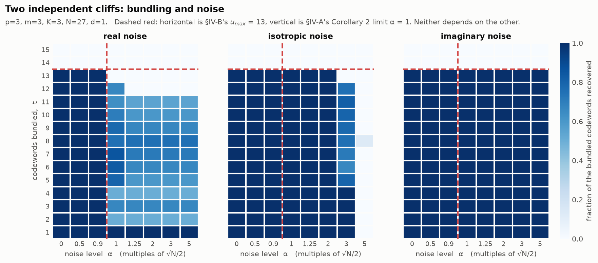
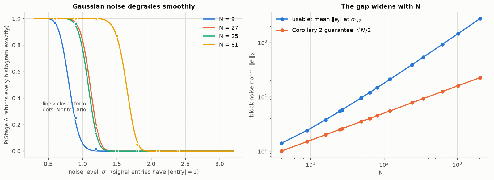
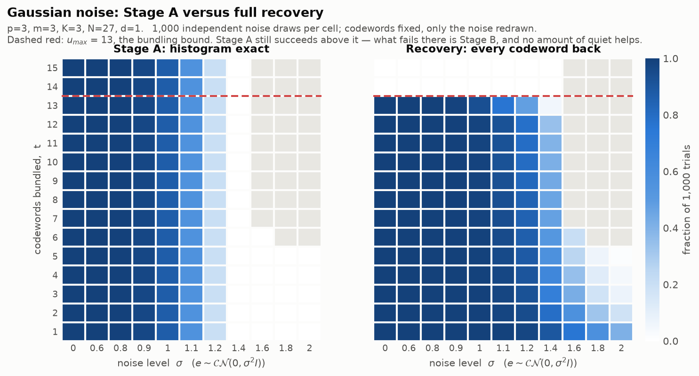

# Histogram recovery: how decoding works, and what breaks it

*Written for: you — a working note on `histogram_recovery.ipynb` and the Streamlit app,
recording what the measurements actually show. Everything here is reproducible from the
repo; figures and data files are named inline.*

Implementation of Deng & Raviv, *Efficient Vector Symbolic Architectures from Histogram
Recovery* (arXiv:2511.01838), at `p = 3, m = 3, K = 3`, so `N = p^m = 27`,
`dim = p^2m = 729`, and `u_max = (N-1)/(K-1) = 13`.

---

## 1. How decoding happens, step by step

A bundle is a sum of `t` hypervectors. Recovering which `t` went in takes two stages,
and the histogram is the object in between.

### The setup: what a codeword is

A message of `K = 3` symbols becomes a hypervector of 729 complex numbers:

```
message  ->  Reed-Solomon  ->  Hadamard  ->  phi  ->  hypervector
  3 syms       27 syms        27x27 grid    unit circle    729 entries
```

The same codeword gets written three ways, and the differences between them *are* the
algorithm:

| form | each cell holds | used for |
|---|---|---|
| **Hadamard** grid | a phase exponent in `0..p-1` | this is what gets bundled |
| **Kautz–Singleton** `W(c)` | `0` or `1` — *did* this symbol occur | what Algorithm 2 decodes |
| **histogram** `h` | a count — *how many* carried it | what Stage A hands back |

For a single codeword the last two coincide: Stage A run on one clean hypervector
returns exactly `W(c)`.

### Bundling destroys the codeword property

```
hv of [1, 1, 2]      [ 1. +0.j   -0.5+0.87j -0.5-0.87j  1. +0.j   ...]
hv of [2, 3, 5]      [ 1. +0.j   -0.5-0.87j -0.5+0.87j  1. +0.j   ...]
hv of [3, 5, 8]      [ 1. +0.j    1. +0.j    1. +0.j   -0.5+0.87j ...]
sum (the bundle)     [ 3. +0.j   -0. +0.j   -0. +0.j    1.5+0.87j ...]
|entry| of the bundle: 0.0 .. 3.0  <- no longer on the unit circle
```

Every codeword has `|entry| = 1` everywhere. The bundle does not. That single fact is
why unbundling needs two papers rather than an inverse.

### Stage A (§IV-A): lattice decoding, back to a histogram

Split the 729 entries into `N = 27` blocks of 27. Block `j` is
`s_j = H h_j' + e_j'`, so recovering `h_j` is nearest-lattice-point decoding in
`H Z^N`. **Lemma 1** shows that for this lattice, nearest-point decoding *is*
coordinatewise rounding, and **Corollary 1** states the result:

```
h_j = round( (1/N) Re( H' s_j ) )
```

One matrix multiply and a rounding. On a clean bundle of `t = 3`:

```
STAGE A -- histogram h (counts):   (25 of 27 symbol-rows are non-empty)
     position:    0  1  2  3  4  5  6  7  8  9 ...
symbol  1:        1  1  1  0  0  0  0  0  0  1 ...
symbol  2:        1  0  1  0  0  0  0  0  0  0 ...
column sums:      3  3  3  3  3  3  3  3  3  3 ...
```

Every column sums to `t`. The data announces how many codewords went in.

### Stage B (§IV-B): throw the counts away, then list-decode

`Y[a,j] = 1` iff `h[a,j] > 0` — the disjunctive channel. `Y` is the entrywise OR of
the `t` Kautz–Singleton matrices. Then Sidorenko–Fischer Algorithm 2:

1. **Interpolate** a curve `Q(x,y)` through every observed `(x_j, a)` pair with
   multiplicity `d`, of `(1, K-1)`-weighted degree below the budget.
2. **Factor** out every `y - f(x)` with `deg f < K`.
3. **Filter** by score — keep those scoring the maximum `dN`. *(Steps 1–2 are
   Algorithm 2; the filter is `histo.pdf`'s own addition.)*

```
points P = {(x_j, a) : Y[a,j] = 1},  n_P = 81
ell found = 3  (equals t = 3)
  f(x) = 2*x^2 + x + 1                    -> [1, 1, 2]   score 27/27
  f(x) = (a + 2)*x^2 + a*x + 2            -> [2, 3, 5]   score 27/27
  f(x) = (2*a + 2)*x^2 + (a + 2)*x + a    -> [3, 5, 8]   score 27/27
```

### Why it stops at exactly 13

A genuine codeword always scores `N` — every symbol it has was observed, by
construction. A spurious one can only collect accidental hits, and **Lemma 2** caps
those at `t(K-1)`, because two distinct degree-`<K` polynomials agree in at most `K-1`
places. So thresholding at `N` separates them exactly while

```
t(K-1) < N      ->      t <= (N-1)/(K-1) = 13 = u_max
```

At `t = 3` that ceiling is `t(K-1) = 6` against a threshold of `27` — an enormous
margin. At `t = 13` it is `26` against `27`, a margin of one.

Note what this bound is: a guarantee that no impostor *can* reach the threshold. At
`t = 14` the guarantee lapses, but an impostor still has to actually exist. Section 5
shows it does not, and that `t = 14` decodes at `d >= 4`.

---

## 2. The noiseless picture: two independent cliffs

Before adding noise, the earlier α-probe experiment (`figures/noise_grid.png`) swept
`t` against a *fixed-norm* perturbation in three directions. Its value is that it maps
where the paper's guarantee is tight.



| direction | `t ≤ u_max`, `α < 1` | `t ≤ u_max`, `α ≥ 1` | `t > u_max` |
|---|---|---|---|
| **real** (`Ha'`, one signed coordinate) | **39/39** | 5/65 | 0/16 |
| **isotropic** (complex Gaussian, normalised) | **39/39** | 43/65 | 0/16 |
| **imaginary** (`iHb'`) | **39/39** | 65/65 | 0/16 |

Three things:

- **Where both guarantees hold, recovery is perfect** — 39/39 in every direction.
- **The two limits are independent.** Past `u_max` nothing returns at *any* noise
  level, including zero. Bundling is a hard combinatorial wall; noise is a separate,
  softer one.
- **Past α = 1 the direction is everything** — 5/65 for real against 65/65 for
  imaginary, because Lemma 1's Voronoi cell is `Hh' + H(-0.5,0.5)^N + iHR^N`:
  bounded in the real directions, **unbounded in the imaginary ones**.

That last point is why the fixed-norm probe is not a channel model, and why section 4
redoes it with Gaussian noise.

## 3. Gaussian noise: the model a real system produces

The probe above fixes `||e_j||` to a chosen value in every block. A system that
recovers a bundled hypervector off a channel does not do that — it perturbs **every
entry independently**, normally. So the model here is

```
s = sum_i c_i + e,     e ~ CN(0, sigma^2 I)   over all N^2 = 729 entries
```

White: the covariance is a scalar times the identity, every entry independent, no
preferred direction. Note `sigma^2` not `sigma` (a variance) and `CN` not `N` — each
entry's real and imaginary parts carry `sigma^2/2` each. Measured against the model at
`sigma = 1`:

```
Var(Re e_k) = 0.49466      predicted sigma^2/2 = 0.50000
Var(Im e_k) = 0.49862      predicted sigma^2/2 = 0.50000
E|e_k|^2    = 0.99585      predicted sigma^2   = 1.00000
corr(Re,Im) = -0.00067      0 -> circular
```

`sigma` is in units of the signal, since a codeword entry has `|entry| = 1`. So
**`sigma = 1` is noise as large as the thing it corrupts.**

The noise is added to `s`, the bundle — the vector the receiver actually gets. `h` and
`Y` are then computed *from* the noisy `s`; nothing is injected into them directly.

### Stage A has a closed form under this model

`H` has orthogonal columns of squared norm `N`, so `(H'e)_i ~ CN(0, N sigma^2)` and

```
a_i = Re(H'e)_i / N  ~  N(0, sigma^2 / 2N)   i.i.d.
```

Lemma 1 needs every one of the `N^2` coordinates of `a` inside `(-0.5, 0.5)`, and they
are independent, so

```
P(Stage A exact) = erf( sqrt(N) / 2 sigma ) ^ (N^2)
```

An equality, not a bound. Checked against Monte Carlo in `gaussian_noise.ipynb` — e.g.
at `N = 27, sigma = 1.0`, predicted `0.8404` against measured `0.8600`.

Note the `1/sqrt(N)`: the transform **averages the noise down**. That processing gain
is why `sigma ~ 1` is survivable at all, and it means **larger fields tolerate more
noise** — `sigma_1/2 ~ sqrt(N / log N)`, so Corollary 2's fixed `sqrt(N)/2` threshold
gets more conservative as `N` grows (about 2x at `N = 27`, over 12x at `N = 2048`).



## 4. How Gaussian noise affects recovery — 1000 trials per cell

`streamlit_app/noise_trials.py`, 120,000 decodes: `t = 1..15` x 8 values of `sigma` x
**1000 independent noise draws each**. The codewords are held fixed and only the noise
is redrawn, so the result isolates the noise rather than mixing it with a change of
code. Data in `streamlit_app/data/noise_trials.json`.



### Full recovery — fraction of 1000 trials returning exactly the bundled set

| t | σ=0 | σ=0.6 | σ=0.8 | σ=0.9 | σ=1 | σ=1.1 | σ=1.2 | σ=1.4 |
|---|---|---|---|---|---|---|---|---|
| 1 | 1.000 | 1.000 | 1.000 | 1.000 | 0.999 | 0.991 | 0.975 | 0.897 |
| 2 | 1.000 | 1.000 | 1.000 | 0.999 | 0.996 | 0.980 | 0.949 | 0.790 |
| 3 | 1.000 | 1.000 | 1.000 | 0.999 | 0.993 | 0.976 | 0.921 | 0.694 |
| 4 | 1.000 | 1.000 | 1.000 | 0.999 | 0.992 | 0.970 | 0.903 | 0.635 |
| 5 | 1.000 | 1.000 | 1.000 | 0.999 | 0.991 | 0.957 | 0.879 | 0.563 |
| 6 | 1.000 | 1.000 | 1.000 | 0.996 | 0.989 | 0.951 | 0.863 | 0.521 |
| 7 | 1.000 | 1.000 | 0.999 | 0.995 | 0.988 | 0.938 | 0.846 | 0.470 |
| 8 | 1.000 | 1.000 | 0.999 | 0.995 | 0.987 | 0.931 | 0.841 | 0.456 |
| 9 | 1.000 | 1.000 | 0.999 | 0.994 | 0.985 | 0.927 | 0.820 | 0.435 |
| 10 | 1.000 | 1.000 | 0.999 | 0.993 | 0.985 | 0.920 | 0.804 | 0.413 |
| 11 | 1.000 | 1.000 | 0.999 | 0.993 | 0.984 | 0.921 | 0.793 | 0.398 |
| 12 | 1.000 | 1.000 | 0.999 | 0.993 | 0.984 | 0.918 | 0.784 | 0.341 |
| 13 ◂ u_max | **1.000** | **1.000** | **0.999** | **0.987** | **0.931** | **0.760** | **0.477** | **0.053** |
| 14 | 0.000 | 0.000 | 0.000 | 0.000 | 0.000 | 0.000 | 0.000 | 0.000 |
| 15 | 0.000 | 0.000 | 0.000 | 0.000 | 0.000 | 0.000 | 0.000 | 0.000 |

### Stage A alone — fraction returning the exact histogram

| t | σ=0 | σ=0.6 | σ=0.8 | σ=0.9 | σ=1 | σ=1.1 | σ=1.2 | σ=1.4 |
|---|---|---|---|---|---|---|---|---|
| 1 | 1.000 | 1.000 | 0.996 | 0.966 | 0.870 | 0.555 | 0.202 | 0.001 |
| 2 | 1.000 | 1.000 | 0.996 | 0.966 | 0.870 | 0.555 | 0.202 | 0.001 |
| 3 | 1.000 | 1.000 | 0.996 | 0.966 | 0.870 | 0.555 | 0.202 | 0.001 |
| 4 | 1.000 | 1.000 | 0.996 | 0.966 | 0.870 | 0.555 | 0.202 | 0.001 |
| 5 | 1.000 | 1.000 | 0.996 | 0.966 | 0.870 | 0.555 | 0.202 | 0.001 |
| 6 | 1.000 | 1.000 | 0.996 | 0.966 | 0.870 | 0.555 | 0.202 | 0.001 |
| 7 | 1.000 | 1.000 | 0.996 | 0.966 | 0.870 | 0.555 | 0.202 | 0.001 |
| 8 | 1.000 | 1.000 | 0.996 | 0.966 | 0.870 | 0.555 | 0.202 | 0.001 |
| 9 | 1.000 | 1.000 | 0.996 | 0.966 | 0.870 | 0.555 | 0.202 | 0.001 |
| 10 | 1.000 | 1.000 | 0.996 | 0.966 | 0.870 | 0.555 | 0.202 | 0.001 |
| 11 | 1.000 | 1.000 | 0.996 | 0.966 | 0.870 | 0.555 | 0.202 | 0.001 |
| 12 | 1.000 | 1.000 | 0.996 | 0.966 | 0.870 | 0.555 | 0.202 | 0.001 |
| 13 ◂ u_max | **1.000** | **1.000** | **0.996** | **0.966** | **0.870** | **0.555** | **0.202** | **0.001** |
| 14 | 1.000 | 1.000 | 0.996 | 0.966 | 0.870 | 0.555 | 0.202 | 0.001 |
| 15 | 1.000 | 1.000 | 0.996 | 0.966 | 0.870 | 0.555 | 0.202 | 0.001 |

### What this shows

**1. The bundling cliff is absolute and noise-independent.** `t = 14` and `t = 15`
return `0.000` at *every* sigma, including `sigma = 0`. No amount of quiet helps,
because what fails there is not the histogram — Stage A is still largely fine above
`u_max`, as the left panel shows. It is Stage B: past `t(K-1) < N` no interpolating
curve fits the budget.

**2. Recovery is far more robust than the histogram.** Averaged over `t = 1..12`:

| sigma | Stage A exact | recovery exact | gap |
|---|---|---|---|
| 0.9 | 0.966 | 0.996 | +0.030 |
| 1.0 | 0.870 | 0.989 | +0.119 |
| 1.1 | 0.555 | 0.948 | +0.393 |
| 1.2 | 0.202 | 0.865 | +0.663 |
| 1.4 | 0.001 | 0.551 | +0.550 |

At `sigma = 1.4` the histogram is essentially *never* exact (0.1%) and yet the bundle
is still recovered **55%** of the time. Stage B's list decoding absorbs a badly
corrupted `Y`: a genuine codeword only needs its own symbols to survive in `Y`, and
losing a few still leaves it scoring near the maximum while impostors stay near
`t(K-1)`.

**3. Tolerance degrades gently with `t`, then falls off.** The sigma at which recovery
drops below 95%:

| t | 1 | 2–6 | 7–12 | 13 | 14+ |
|---|---|---|---|---|---|
| sigma at 95% | 1.4 | 1.2 | 1.1 | 1.0 | — (never recovers) |

**4. `t = u_max` is the fragile row.** At `t = 13` the margin in Lemma 2 is `26`
against a threshold of `27` — exactly one. It shows: `0.931` at `sigma = 1.0` where
`t = 12` gives `0.984`, and `0.477` at `sigma = 1.2` where `t = 12` gives `0.784`.
**Running at the theoretical maximum is measurably more brittle than backing off by
one.** That is the practical recommendation from this data.

---

## 5. Does increasing `d` recover extra codewords?

**Yes — exactly one, and only at `d >= 4`.** `t = 14` decodes, one past
`u_max = 13`, and `t = 15` fails at every `d` tried. The extra reach is real but it is
a single codeword, bought at roughly 1000x the decode time.

This section originally concluded the opposite, on an argument that is sound but proves
less than it appears to. The argument is worth keeping, because understanding why it is
not enough is the whole result.

### The argument that says `d` cannot help

`d` is the Guruswami-Sudan multiplicity: the interpolated curve must vanish to order
`d` at every observed point. The *witness* curve — the one whose existence is
guaranteed, built from the answer itself — is `(prod_i (y - f_i(x)))^d`. It has to be
the `d`-th power, because at a point where only one `f_i` passes, the plain product
vanishes to order 1, not `d`. So:

```
required weighted degree  =  d * t(K-1)
interpolation budget      =  d * N
```

`d` cancels, and the condition collapses to `t(K-1) < N`, i.e. `t <= u_max = 13`,
**independent of `d`**.

Every step of that is correct. What it establishes is that *this particular curve* stops
fitting at `t = 14` — it never shows the witness curve is the only one that would work.
Interpolation does not look for `Q*`; it looks for anything in the kernel. So the
question is not whether `Q*` fits but whether the kernel is empty, and that is a
counting question in which `d` does **not** cancel:

```
unknowns     =  #{(i,j) : i + j(K-1) <= dN,  j <= ell}      ~ d^2
constraints  =  n_P * d(d+1)/2                              ~ d^2
```

Both sides are quadratic in `d`. Which one wins is a question about constants, and it
has to be computed.

### `ell` has to be large, or none of this is visible

The unknown count rises with `ell` and then saturates, because the budget forces
`j <= dN/(K-1)` however large `ell` is. The only `ell` worth testing is the saturating
one, `ell_sat(d) = floor(dN/(K-1))`: 13, 27, 40, 54, 67 for `d = 1..5`.

This is why the effect was missed twice. At `d = 1` the first `ell` admitting a curve is
`ell = t`, so walking `ell` upward from 2 and stopping at the first hit — what
`core.unbundle` does — is correct there. At `d = 4` the curve lives at `ell = 54`, which
is past `unbundle`'s default `ell_max = 40`. **The shipped decoder cannot reach these
curves at all.** The measurements below call `core.attempt` with an explicit
`(budget, ell)` instead.

### Measured, at `ell_sat(d)`

| d | ell | monomials | t = 13 constraints | kernel | found | t = 14 constraints | kernel | found |
|---|---|---|---|---|---|---|---|---|
| 1 | 13 | 196 | 285 | 1 | 13 | 305 | 0 | 0 |
| 2 | 27 | 756 | 855 | 3 | 13 | 915 | 0 | 0 |
| 3 | 40 | 1681 | 1710 | 51 | 13 | 1830 | 0 | 0 |
| 4 | 54 | 2970 | 2850 | 200 | 13 | 3050 | **27** | **14** |
| 5 | 67 | 4624 | 4275 | 429 | 13 | 4575 | **156** | **14** |

At `t = 15` (`n_P = 323`, constraints 323, 969, 1938, 3230, 4845) the kernel is **0 for
every `d` from 1 to 5**.

Two things in that table are worth dwelling on.

**`d = 4` succeeds with the count against it.** 2970 unknowns against 3050 constraints
is a deficit of 80, yet the kernel has dimension 27. The constraint rows are not
independent. `d = 5` is the first row where the count goes positive (4624 vs 4575), so
the counting argument predicts `d = 5` as the first success — and it is wrong by one.
Only measurement settles it.

**The 14 recovered codewords are certified, not merely returned.** Each passed the score
filter at the maximum `dN`, meaning its symbol was observed at every one of the 27
positions. These are genuine recoveries.

### Why this does not contradict Lemma 2

The score argument says a spurious codeword scores at most `d*t(K-1)` against a genuine
`d*N`, so the filter is provably sound while `t(K-1) < N` — again with `d` cancelling,
again giving 13.

That is a guarantee that no impostor *can* reach the threshold. At `t = 14`,
`t(K-1) = 28 > 27`, so the guarantee lapses: an impostor now *could* score the maximum.
Whether one actually does is a property of the particular codewords bundled, and here
none does. The gap between "no longer provably safe" and "actually produces a wrong
answer" is the entire source of the extra reach.

So what is lost past `u_max` is the *a priori* promise, not the *a posteriori* check.
Each answer is still verified individually; what you can no longer do is promise in
advance that verification will succeed.

### What `d` actually costs

Seconds per decode, measured at `ell_sat(d)`:

| d | t = 13 | t = 14 | t = 15 |
|---|---|---|---|
| 1 | 0.3 | 0.2 | 0.2 |
| 2 | 7.2 | 6.5 | 8.0 |
| 3 | 53.8 | 55 | 61 |
| 4 | 270 | 305 | 317 |
| 5 | 952 | 1094 | 1133 |

Roughly `d^4` — the interpolation matrix is about `n_P*d(d+1)/2` rows by
`ell_sat(d)`-many columns, and both grow like `d^2`. Going from `d = 1` to `d = 4` costs
about **1000x** and buys exactly one additional codeword; `d = 5` costs another 3.5x and
buys nothing beyond what `d = 4` already found.

The kernel also grows steeply with `d` (1 -> 3 -> 51 -> 200 -> 429 at `t = 13`), so
there are many more curves to choose from. At `t <= 13` they all describe the same `t`
codewords, and the extra dimensions are redundant. At `t = 14` that redundancy is the
point: the kernel is non-empty only because the constraints are dependent.

### Does `d` at least buy noise robustness?

Here the answer is no. `d` extends the noiseless reach by one, but it might also plausibly help when `Y` is corrupted
— a higher multiplicity is a stronger constraint and could reject bad curves. Measured
at `t = 6` and `t = 10`, 30 independent noise draws per cell:

| t | sigma | d = 1 | d = 2 | Stage A (both) | sec/decode, d=1 → d=2 |
|---|---|---|---|---|---|
| 6 | 1.1 | 28/30 | **28/30** | 18/30 | 0.24 → 2.03 (8.5x) |
| 6 | 1.2 | 26/30 | **26/30** | 3/30 | 0.25 → 2.04 (8.2x) |
| 6 | 1.4 | 19/30 | **19/30** | 0/30 | 0.26 → 2.10 (8.1x) |
| 10 | 1.1 | 27/30 | **27/30** | 18/30 | 0.62 → 6.90 (11x) |
| 10 | 1.2 | 24/30 | **24/30** | 3/30 | 0.62 → 6.90 (11x) |
| 10 | 1.4 | 17/30 | **17/30** | 0/30 | 0.64 → 7.01 (11x) |

Identical in **all six** cells — not close, exactly equal — at 8-11x the runtime, and
the penalty grows with `t`. That is consistent with the mechanism:
noise damages `Y` by deleting observed pairs, which lowers a genuine codeword's score
from `dN` to `d(N - missing)` — and since the threshold is also `dN`, the multiplicity
cancels there too. `d` does not appear anywhere in what decides success.

Stage A is of course identical across `d` by construction, since `d` only enters
Stage B.

**Conclusion: at `d = 1` this code is already at its ceiling.** `u_max = 13` is a
property of `(N, K)`, not of how hard the decoder tries. To bundle more, raise `N` or
lower `K` — `u_max = (N-1)/(K-1)` — not `d`.

*(Caveat: this is the noiseless, full-agreement setting, where the genuine codewords
agree with `Y` in all `N` positions. Sidorenko–Fischer's bound where `d` does appear,
`u <= d/(d+1) · (n-tau)/(k-1)`, assumes a nonzero error budget `tau`; with `tau = 0`
and the score filter, the reach is `u_max` at every `d`.)*

---

## 6. Summary

**How decoding works.** Bundle → Stage A (lattice decode each block back to a
histogram, by rounding) → Stage B (drop the counts, interpolate a curve through the
observed symbols, factor it, keep the factors scoring the maximum). The histogram is
the pivot: Stage A is exact linear algebra, Stage B is list decoding.

**Three ceilings, and they are not the same thing:**

| ceiling | value here | set by | behaves like |
|---|---|---|---|
| bundling, `u_max = (N-1)/(K-1)` | **13** | `N` and `K` alone | a cliff — `t = 14` only at `d >= 4`, `t = 15` never |
| noise, Stage A | `sigma ≈ 1.1` | `erf(sqrt(N)/2 sigma)^(N^2)` | a smooth curve |
| noise, full recovery | `sigma ≈ 1.4` | Stage A + Stage B's slack | a smooth curve, well right of Stage A |

**Does `d` help?** Barely, and only in one sense. It extends the noiseless reach by
exactly one codeword: `t = 14` decodes at `d = 4` and `d = 5`, `t = 15` at neither.
The cancellation argument (`d` scales budget and required degree equally) correctly
shows the *witness* curve stops fitting, but interpolation accepts any curve in the
kernel, and at `d >= 4` the constraints are dependent enough to leave one. The cost
is about `d^4` — 1000x from `d = 1` to `d = 4`. It buys no noise robustness at all:
`d = 2` returns results identical to `d = 1` in all six noise cells tested.

**Does noise move the bundling cliff?** No. At `d = 1`, `t = 14` returns nothing even at `sigma = 0`.
The two limits are genuinely independent, which is the single most useful thing in
this report: *if you are failing, first check which wall you are against*, because the
fixes are completely different (raise `N` / lower `K` versus lower `sigma`).

**Practical settings for `p=3, m=3, K=3`:** bundle at most **12**, not 13 — the last
row before the cliff is measurably more fragile (0.931 vs 0.984 at `sigma = 1.0`) for
no gain. Noise up to `sigma ≈ 1.0` is essentially free (98.9% recovery). Keep `d = 1` — the
one extra codeword at `d = 4` costs 1000x and lands in the regime where Lemma 2 no
longer guarantees anything.

## Reproducing

```bash
uv sync --group app --group sage
uv run --group app --group sage streamlit run streamlit_app/app.py   # tabs 4 and 5
uv run --group sage --group app python streamlit_app/noise_trials.py # the 120k grid
```

| artefact | what it is |
|---|---|
| `gaussian_noise.ipynb` | the AWGN model, the closed form, Monte Carlo validation |
| `histogram_recovery.ipynb` | the noiseless walkthrough this report's section 1 follows |
| `figures/gaussian_noise_grid.png` | section 4's grid, 1000 trials/cell |
| `figures/gaussian_stage_a.png` | the closed form and its scaling with `N` |
| `figures/noise_grid.png` | section 2's fixed-norm probe |
| `streamlit_app/data/noise_trials.json` | 120,000 decodes, aggregated |
| `gs_bound.ipynb` | section 5 end to end: the bound, the measurement, the crossing |
| `streamlit_app/data/gs_bound_3_3_3.jsonl` | section 5's measurements, `d = 1..5` x `t = 13..15` |
| `streamlit_app/data/d_sweep.jsonl` | the earlier `d` reach experiment |

### A note on method

Two shortcuts were needed to make 120,000 decodes affordable, and both were checked
rather than assumed:

- **`ell` bracket.** `unbundle` walks `ell` upward from 2 and succeeds at `ell = t`,
  wasting `t-2` interpolations per decode. Bracketing around `t` is 3.4x faster;
  verified identical on 255 cases (`t = 1..17` x 5 sigma x 3 seeds), **0 mismatches**.
- **Per-process isolation.** Sage's Alekhnovich root finder segfaults outright on some
  inputs — a SIGSEGV, not an exception — so the sweeps run work in child processes and
  log the offending group rather than dying.

One caveat worth stating: each `(t, sigma)` cell redraws the noise 1000 times but keeps
**the same `t` codewords**. The numbers are averages over noise, not over codeword
choice. Checking that directly at `t = 6, sigma = 1.2` with 40 draws each:

| message set | exact |
|---|---|
| default (`nth_message`) | 32/40 |
| random set 1 | 35/40 |
| random set 2 | 35/40 |
| random set 3 | 37/40 |

So codeword choice does move the number, and the fixed set used throughout is on the
**pessimistic** side — the tables in section 4 are if anything slightly conservative. A
full codeword-averaged sweep was not run.
